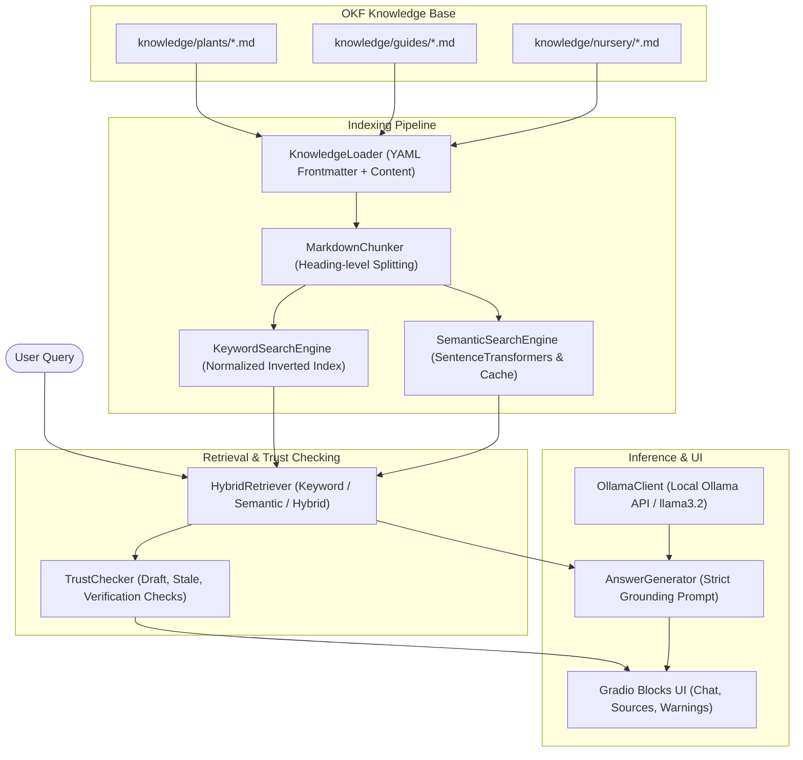

# 🌱 Plant Care AI: Local RAG Knowledge Assistant

**Plant Care AI** is a local, privacy-preserving botanical and nursery assistant that answers plant-care questions strictly grounded in a structured Markdown knowledge base (OKF format) and local language model inference via [Ollama](https://ollama.ai).

---

## 📌 Project Objective

The system enables home gardeners, nursery staff, and plant enthusiasts to inquire about:
- **Indoor and outdoor plants** (light, watering, soil, temperature, humidity).
- **Flowering, medicinal, fruit, and foliage species** (cuttings, seeds, offsets/pups).
- **Common plant diseases and physiological problems** (e.g., yellowing leaves, overwatering, root rot).
- **Grounded nursery pricing and availability** (strictly distinguishing verified local pricing from unverified/unknown data).
- **Related plants and substitute recommendations**.

---

## ✨ Features

- **Strict Knowledge Grounding**: Will not hallucinate facts or invent nursery prices. Unverified or missing data is explicitly flagged.
- **OKF-Style Markdown Notes**: Human-readable knowledge files using YAML frontmatter (`type`, `status`, `verified`, `stale_after`, `tags`).
- **Heading-Based Chunking**: Automatically segments Markdown documents by sections (`## Watering`, `## Sunlight`, etc.) while maintaining document metadata and context.
- **Multi-Modal Retrieval Strategy**:
  - **Keyword Search**: Offline token frequency and weighted section/tag matching.
  - **Semantic Search**: Vector similarity using Sentence Transformers (`sentence-transformers/all-MiniLM-L6-v2`) with lazy loading and disk caching.
  - **Hybrid Search**: Combines keyword rank and normalized semantic similarity with graceful fallback to keyword search if offline.
- **Trust & Freshness Engine**: Warns users when knowledge notes are drafts, unverified, or have exceeded their `stale_after` expiration date.
- **Local Ollama LLM**: Supports models such as `llama3.2` locally with connection diagnostics and automatic fallback to direct extracted notes if the LLM is unavailable.
- **Interactive Gradio UI**: Clean conversation interface with source attribution badges, trust warnings, related plant suggestions, and live index rebuilding.

---

## 🏛️ Architecture & RAG Flow



---

## 📁 Repository Structure

```
Plant-care-ai/
├── knowledge/
│   ├── plants/
│   │   ├── money-plant.md
│   │   ├── rose-plant.md
│   │   ├── hibiscus-plant.md
│   │   ├── tulsi-plant.md
│   │   └── aloe-vera.md
│   ├── guides/
│   │   └── watering-basics.md
│   └── nursery/
│       └── nursery-pricing-template.md
├── src/
│   ├── __init__.py
│   ├── config.py              # Configuration & environment variables
│   ├── knowledge_loader.py    # YAML frontmatter parser & file loader
│   ├── chunker.py             # Markdown section chunking
│   ├── keyword_search.py      # Offline TF/weighted keyword search
│   ├── semantic_search.py     # SentenceTransformers vector search & caching
│   ├── retriever.py           # Unified keyword/semantic/hybrid retriever
│   ├── ollama_client.py       # Ollama REST client & diagnostic helpers
│   ├── answer_generator.py    # Grounded prompt construction & generation
│   ├── trust_checker.py       # Draft, stale, and unverified warning checks
│   └── chatbot.py             # Main orchestrator
├── tests/
│   ├── test_knowledge_loader.py
│   ├── test_chunker.py
│   ├── test_retrieval.py
│   ├── test_trust_checker.py
│   └── test_evaluation_dataset.py  # 10-question evaluation benchmark
├── app.py                     # Interactive Gradio application
├── requirements.txt           # Python dependencies
├── .env.example               # Example configuration
├── .gitignore
└── README.md
```

---

## ⚙️ Prerequisites

1. **Python 3.10+** (Python 3.12 recommended)
2. **Ollama**: Download and install from [ollama.com](https://ollama.ai).

---

## 🚀 Setup & Installation

### 1. Clone & Set Up Environment

```bash
git clone <repository-url>
cd Plant-care-ai

# Create virtual environment (optional but recommended)
python -m venv venv

# Activate virtual environment
# Windows:
.\venv\Scripts\activate
# Linux/macOS:
source venv/bin/activate
```

### 2. Install Dependencies

```bash
pip install -r requirements.txt
```

### 3. Configure Environment

Copy `.env.example` to `.env` to customize settings (defaults work out-of-the-box):

```bash
cp .env.example .env
```

Key environment variables:
- `OLLAMA_BASE_URL`: URL of the local Ollama instance (default: `http://localhost:11434`)
- `OLLAMA_MODEL`: Target model (default: `llama3.2`)
- `EMBEDDING_MODEL`: Sentence transformer model (default: `sentence-transformers/all-MiniLM-L6-v2`)
- `DEFAULT_RETRIEVAL_MODE`: `hybrid`, `semantic`, or `keyword` (default: `hybrid`)
- `RETRIEVAL_TOP_K`: Number of chunks retrieved (default: `4`)

### 4. Setup Ollama Local Model

In your terminal:

```bash
# Verify Ollama is running
ollama list

# Pull the default local model
ollama pull llama3.2

# Test running the model
ollama run llama3.2
```

*(Note: If Ollama is not running, Plant Care AI will automatically fall back to providing direct, structured excerpts from the matching knowledge chunks without crashing).*

---

## 🖥️ Launching the Application

Run the Gradio web interface:

```bash
python app.py
```

Open your browser and navigate to:
**`http://127.0.0.1:7860`**

---

## 🌿 How to Add New Plant Notes

You can add any new plant note without modifying Python code:
1. Create a `.md` file in `knowledge/plants/` (e.g., `snake-plant.md`).
2. Add YAML frontmatter at the top:
   ```yaml
   ---
   type: Plant
   title: Snake Plant Care
   description: Snake plant care guide and watering frequency.
   tags:
     - snake-plant
     - indoor-plant
     - low-light
   status: active
   verified: true
   updated_at: 2026-10-10
   ---
   ```
3. Use `##` Markdown headings for each section (`## Overview`, `## Watering`, `## Sunlight`, `## Soil`, `## Price Information`, `## Related Plants`).
4. In the running Gradio app, click **"Rebuild Knowledge Index"** in the sidebar to re-index automatically.

---

## 🧪 Running Automated Tests

Run the complete test suite including unit tests and the 10-query evaluation benchmark:

```bash
python -m pytest -v
```

---

## 💡 Example Questions

- *"How do I care for a Money Plant?"*
- *"How much sunlight does a Rose need?"*
- *"How can I grow Tulsi at home?"*
- *"Why are my Hibiscus leaves turning yellow?"*
- *"What is the price of an Aloe Vera plant?"*
- *"Suggest plants similar to Money Plant."*
- *"Compare Rose and Hibiscus care requirements."*

---

## 🔒 Verification & Nursery Price Policy

- **No Hallucinated Prices**: Real nursery prices fluctuate significantly by nursery, location, pot size, and season.
- If a note states `Nursery price: Not available yet.`, the system will report that pricing is unavailable rather than guessing.
- Real nursery prices can be documented by setting `verified: true` and adding verified catalog entries in `knowledge/nursery/`.
